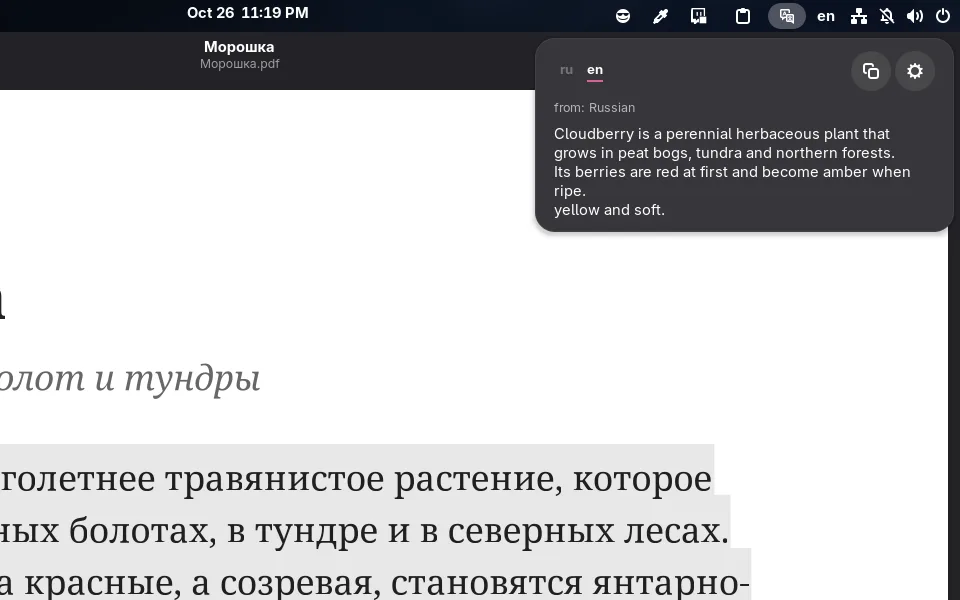
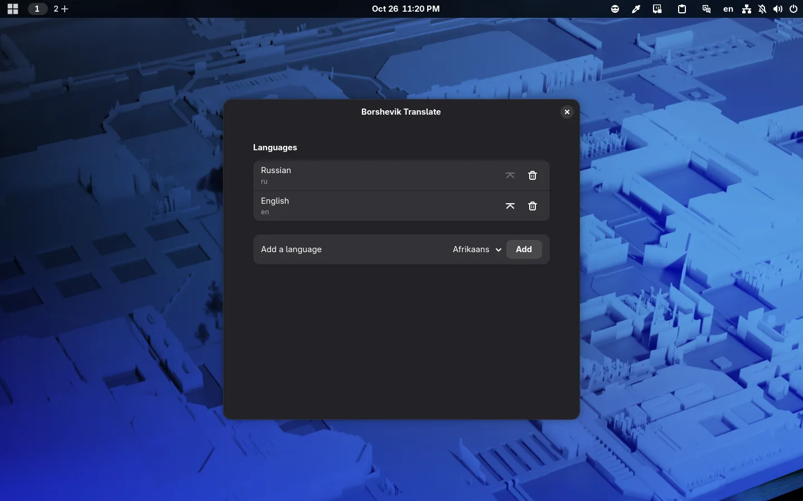

# Translate the selected text

Borshevik now has a translator: select text in any app and press **Super+T** or the translator's icon on the panel — the translation opens right under it. No copying, no browser, no separate app.

## How it works

The panel has a tab for each of your languages at the top. Text is translated into the language of the tab you chose last, and text already in that language into the next one. A button next to the translation copies it. A click anywhere else or Esc closes the panel.

## Languages

By default they are the languages of your keyboard layouts, English last: with Russian and English layouts, Russian text is translated into English and English into Russian. In the settings, languages can be added, removed and moved to the top.

Only the selected text is translated; the clipboard is left alone. Translation goes through Google Translate, so the selected text is sent to Google.
