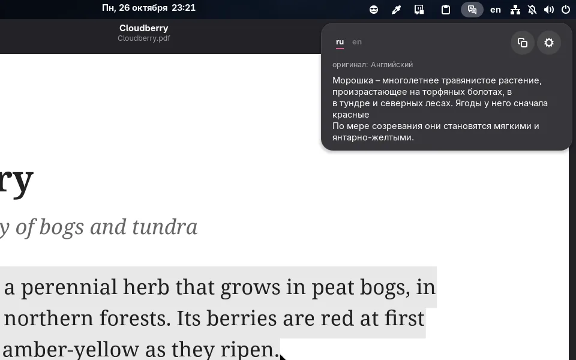
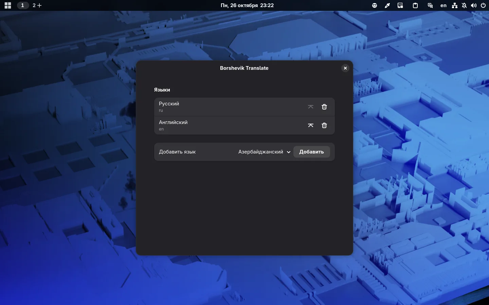

# Перевод выделенного текста

В Borshevik появился переводчик: выделите текст в любом приложении и нажмите **Super+T** или значок переводчика на панели — перевод откроется прямо под ним. Ничего не нужно копировать, открывать браузер или отдельную программу.

## Как это работает

Наверху панели — вкладка для каждого вашего языка. Текст переводится на язык вкладки, выбранной последней, а текст, который уже на этом языке, — на следующий. Перевод можно скопировать кнопкой рядом. Панель закрывается кликом в любом другом месте или клавишей Esc.

## Языки

По умолчанию это языки ваших раскладок клавиатуры, английский — последним: с русской и английской раскладками русский текст переводится на английский, а английский — на русский. В настройках языки можно добавить, убрать и поднять наверх.

Переводится только выделенный текст, буфер обмена не трогается. Перевод идёт через Google Translate, поэтому выделенный текст отправляется в Google.
