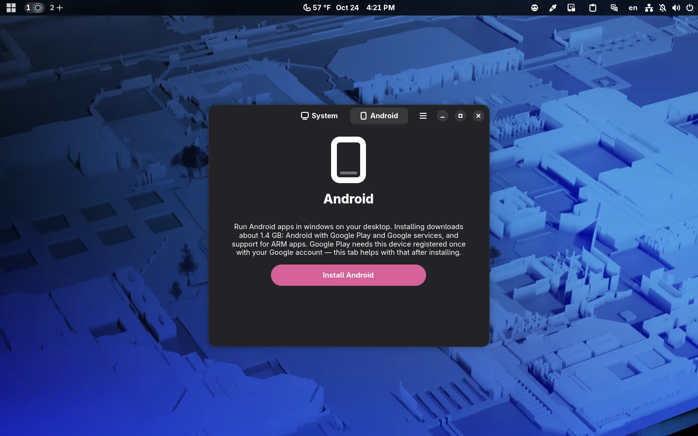
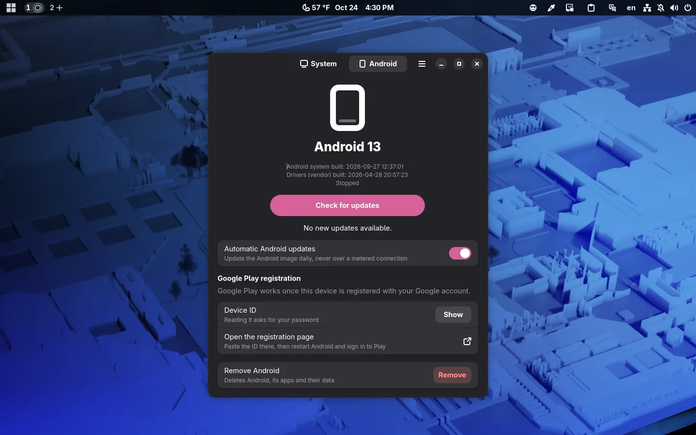
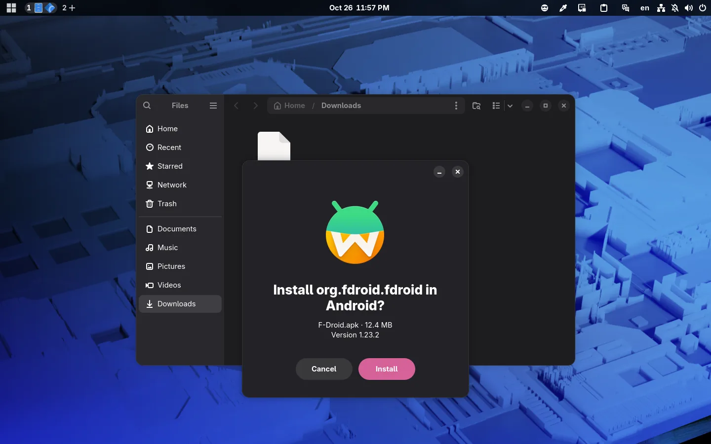

# Android apps on Borshevik

**Borshevik** now runs **Android** apps — in windows of their own, next to your desktop apps. **Google**'s services and **Google Play** work: apps install from there and keep themselves up to date.

## How to turn it on

**Android** is not part of the default setup; you install it when you want it:

- by checking **Android applications support** in the **App Manager**;
- or with **Install Android** on the **Android** tab of the **Image Manager**.

It downloads about 1.4 GB: **Android** with **Google Play** and **Google**'s services. Most apps on **Google Play** are built only for the **ARM** processors of phones, so an **ARM** translator goes in too, picked for your processor: **Intel**'s own on **Intel**, **Google**'s on **AMD**. On **NVIDIA** graphics, **Android** draws in software and runs slower.

## Registering with Google Play

**Google** asks for the device to be registered with your account once. The **Android** tab shows the device ID and has a button that opens the registration page: paste the ID there and sign in to **Google Play**.

## Installing APKs

An APK downloaded from somewhere other than **Google Play** installs with a double click: the installer shows the package and its version and offers to install it — or to update it, if it is already installed.

## Feels like part of the system

**Android** follows **GNOME**'s dark style and accent colour:

## Updates

**Android** updates separately from the system, once a day, and waits while you're on a phone's hotspot or another metered connection.
