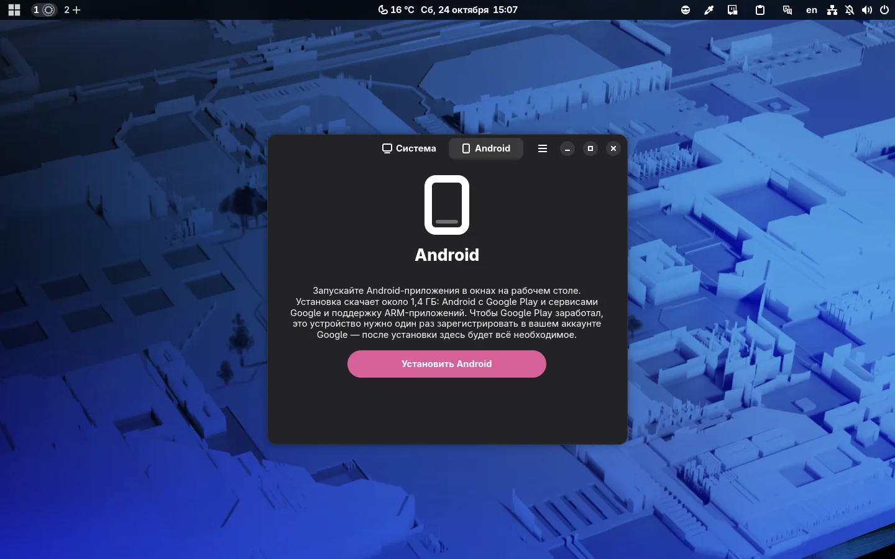
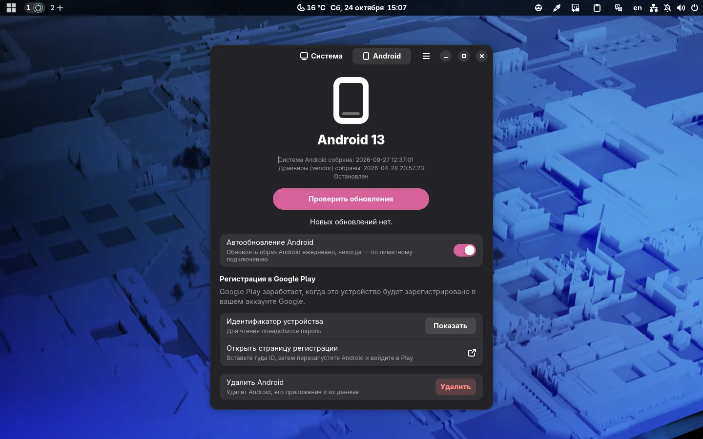
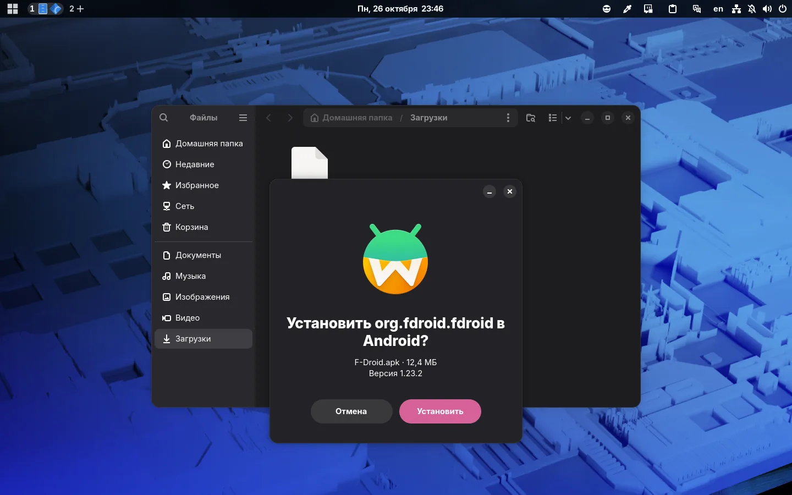

# Android-приложения в Borshevik

**Borshevik** теперь запускает **Android**-приложения — в отдельных окнах, рядом с обычными программами. Приложения ставятся из **Google Play** и обновляются сами, а уведомления, вход через **Google** и всё, что зависит от сервисов **Google**, работает.

## Как включить

**Android** не входит в систему по умолчанию и ставится по желанию:

- галочкой **Поддержка Android-приложений** в **App Manager**;
- или кнопкой **Установить Android** на вкладке **Android** в **Image Manager**.

Скачается около 1,4 ГБ: **Android** с **Google Play** и сервисами **Google**. Большинство приложений в **Google Play** собраны только под **ARM**-процессоры телефонов, поэтому ставится и транслятор с **ARM**, подобранный под ваш процессор: на **Intel** — собственный от **Intel**, на **AMD** — от **Google**. На видеокартах **NVIDIA** **Android** рисует программно и работает медленнее.

## Регистрация в Google Play

**Google** один раз просит зарегистрировать устройство на ваш аккаунт. Вкладка **Android** покажет идентификатор устройства и откроет страницу регистрации: вставьте туда ID, перезапустите **Android** и войдите в **Google Play**.

## Установка APK

APK-файл, скачанный не из **Google Play**, ставится двойным щелчком: установщик покажет пакет и версию и спросит, установить его или обновить.

## Выглядит как часть системы

**Android** подхватывает тёмную тему и акцентный цвет **GNOME**:

## Обновления

**Android** обновляется отдельно от системы, раз в день и никогда — через лимитное подключение, а откат **Borshevik** возвращает и прежнюю версию **Android**.
