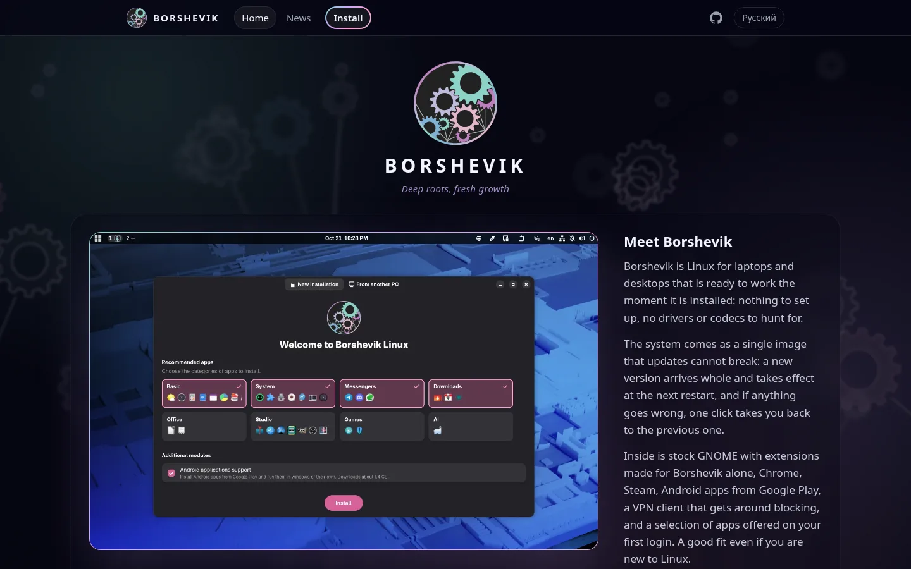

# A new website for Borshevik

**borshevik.org** has been redone: it now shows what the system can do, walks you through the installation step by step with videos, and has a news section.

## What the system can do

The home page covers everything **Borshevik** can do: updates that never break the system, **Android** apps, games, VPN and our work on **GNOME** — from workspaces on the panel to translating selected text. Most sections come with a short video.

## Installation step by step

The installation page takes you from downloading the image to your first login: which image to choose — standard or **NVIDIA** — how to write the USB stick with **Fedora Media Writer**, boot from it and go through the installer. Writing the stick, the installer and confirming the **NVIDIA** driver's key are shown in videos you can pause and scrub to the step you need.

## News

New features and important changes are announced here now, in the News section.

The site opens in your browser's language — English or Russian — and the switch is in the header. The old links to the images work as before.

------------ you are here ------------

More good news is on the way — stay tuned.
