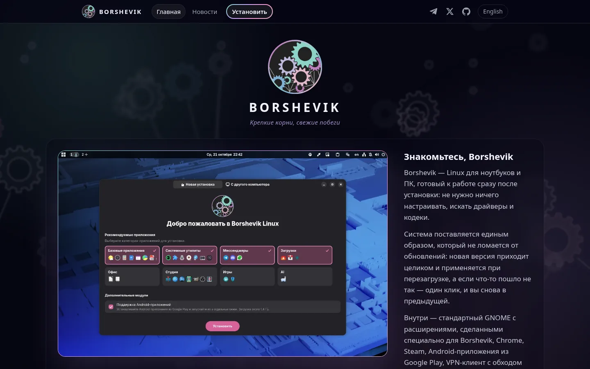

# Новый сайт Borshevik

**borshevik.org** обновился: теперь здесь видно, что умеет система, установка расписана по шагам с видео, и появился раздел новостей.

## Что умеет система

На главной — всё, что **Borshevik** даёт из коробки: обновления, которые не ломают систему и откатываются в один шаг, **Android**-приложения, игры, VPN и доработки **GNOME** — рабочие столы на панели, расстановку окон, перевод выделенного текста, поиск приложений в любой раскладке. У большинства разделов есть короткое видео, как это работает.

## Установка по шагам

Страница установки ведёт от скачивания образа до первого входа: какой образ выбрать — стандартный или для **NVIDIA**, как записать флешку в **Fedora Media Writer**, загрузиться с неё и пройти установщик. Запись флешки, установщик и подтверждение ключа драйвера **NVIDIA** показаны на видео: их можно остановить и перемотать к нужному шагу.

## Новости

О новых возможностях и важных изменениях теперь рассказываем здесь, в разделе «Новости».

Сайт открывается на языке браузера — русском или английском, переключатель есть в шапке. Старые ссылки на образы работают как прежде.

------------ вы здесь ------------