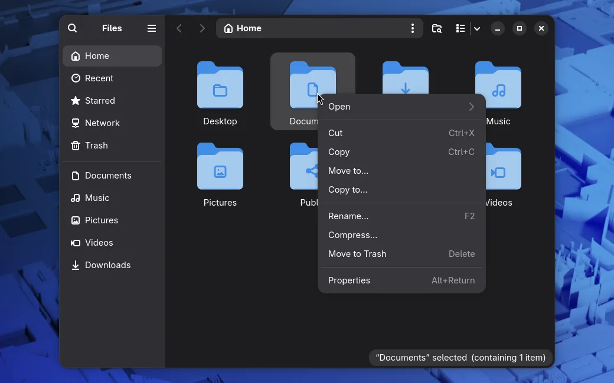

# We patched mutter so GNOME no longer crashes

We patched **mutter** so **GNOME** no longer crashes, or at least crashes less often. **Mutter** is the part of **GNOME**'s **Wayland** display server that handles input and windows.

## When GNOME crashed

Three things had to come together:

- an app has a menu open, a context menu for instance;
- the mouse button is held down;
- the overview opens, or the desktop switches workspaces with an animation.

It is very easy to reproduce by hand: open any menu in **Nautilus**, press the mouse button in the window outside the menu and, without letting go, press the **Super** key. At that moment **GNOME** crashes along with all your apps, and you find yourself on the login screen (**GDM**). The bug appeared in **GNOME 50**, and **GNOME** itself has not fixed it yet — here is [the report on GNOME's GitLab](https://gitlab.gnome.org/GNOME/mutter/-/issues/5121) and [the issue filed on our GitHub](https://github.com/komorebinator/borshevik/issues/87).

::video crash.en.mp4 A menu opened, a press in the window outside it held, Super pressed — GNOME goes down to the login screen

## The patch

There is no ready fix upstream yet. We did not wait for upstream, because our **Workspace Manager** switches workspaces automatically, which makes the bug more likely to hit. And anyway, a desktop shell has no business crashing in 2026.

If something does not work, [open an issue on GitHub](https://github.com/komorebinator/borshevik/issues). We gladly accept reports written with the help of AI too.

Thanks, everyone, for your attention!
