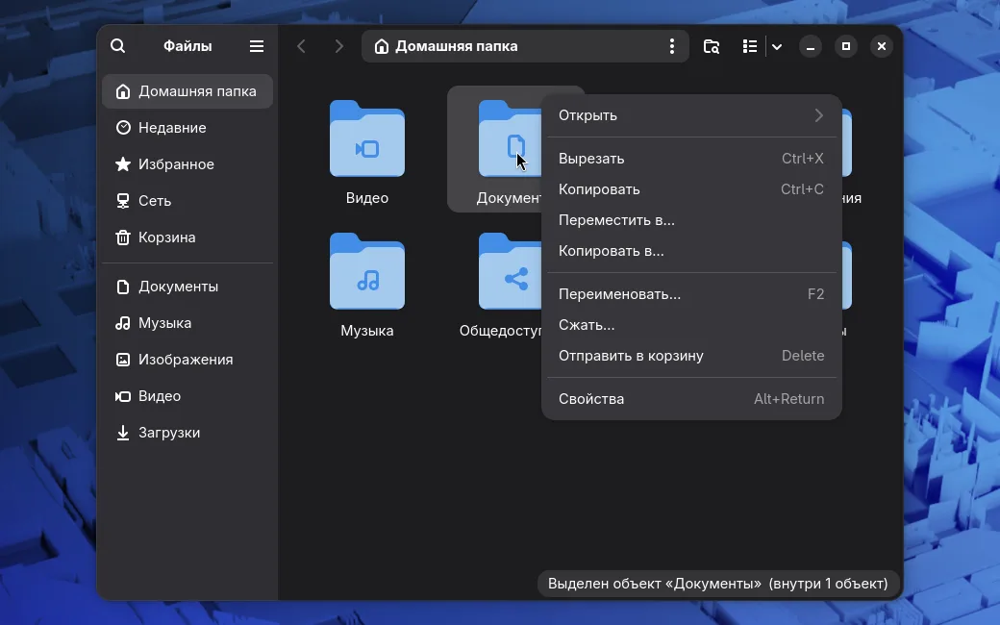

# Мы пропатчили mutter, чтобы GNOME больше не падал

Мы пропатчили **mutter**, чтобы **GNOME** больше не падал, или по крайней мере падал реже. **Mutter** — это часть дисплейного сервера **GNOME** для **Wayland**, отвечающая за обработку ввода и работу с окнами.

## Когда GNOME падал

Для этого должны были совпасть три вещи:

- у приложения открыто меню, например контекстное;
- кнопка мыши находится в зажатом состоянии;
- открывается обзор или рабочий стол переключается на другой с анимацией.

Воспроизвести вручную очень легко: откройте в **Nautilus** любое меню, нажмите кнопку мыши в окне за пределами меню и, не отпуская её, нажмите клавишу **Super**. В этот момент **GNOME** падает вместе со всеми приложениями, и вы оказываетесь на экране входа в систему (**GDM**). Ошибка появилась в **GNOME 50**, и в самом **GNOME** её пока не исправили — вот [отчёт на GitLab GNOME](https://gitlab.gnome.org/GNOME/mutter/-/issues/5121) и [зарегистрированная проблема на нашем GitHub](https://github.com/komorebinator/borshevik/issues/87).

::video crash.ru.mp4 Открываем меню, нажимаем в окне за его пределами и, не отпуская кнопку, жмём Super — GNOME падает до экрана входа

## Патч

Пока что готового решения в апстриме нет. Мы не стали ждать апстрим, поскольку наш **Workspace Manager** автоматически переключает столы, а значит, вероятность поймать ошибку повышается. Да и вообще — оболочке падать в 2026 году не положено.

Если что-то не работает — [заведите задачу на GitHub](https://github.com/komorebinator/borshevik/issues). Отчёты, составленные с помощью AI, мы тоже охотно принимаем.

Всем спасибо за внимание!
