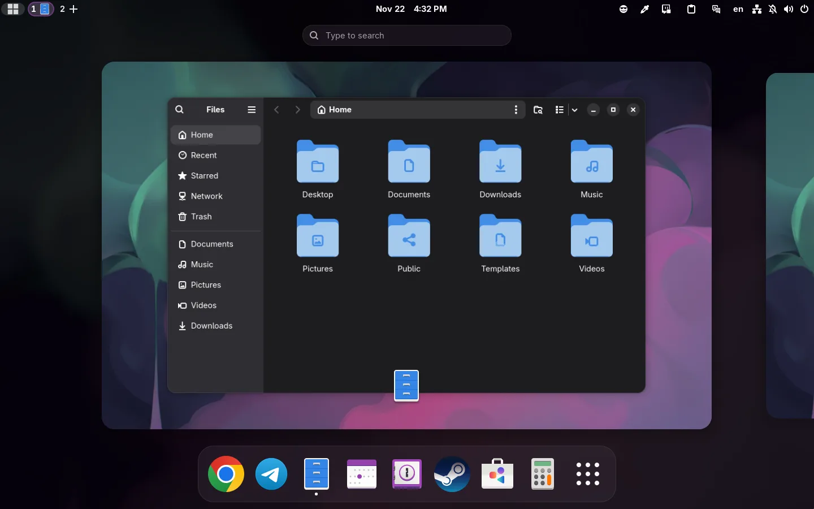
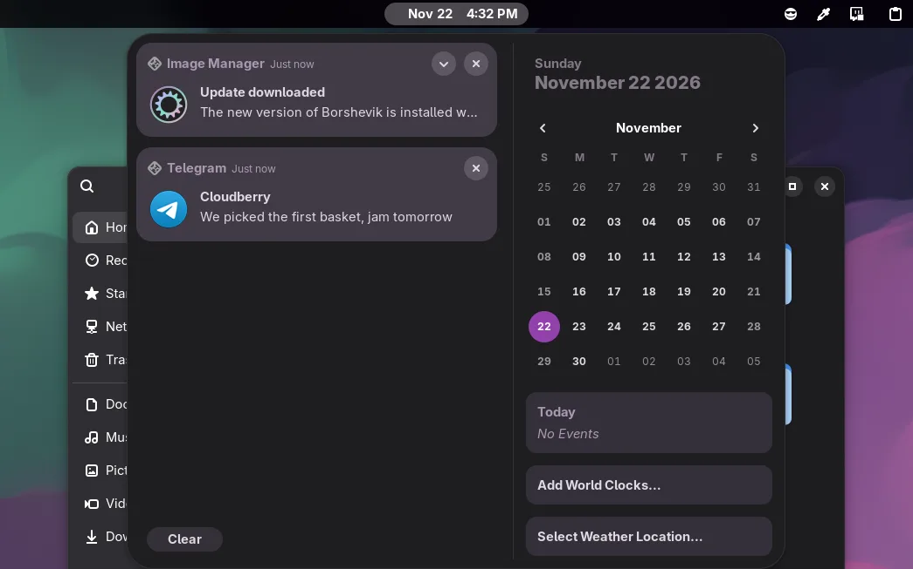
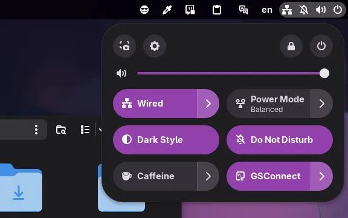

# Borshevik's look, refreshed

We have refreshed how **Borshevik** looks: the panel, the overview, the dock and app folders are now made of glass — your wallpaper shows through, blurred — and the glass adapts to it and to the accent colour you have picked. This is done by a new extension, **Borshevik Glass**, which replaces **Blur my Shell**.

## Light and dark

In **GNOME**'s light style the glass is light, in the dark style it is dark. You can now pick an accent colour without minding the wallpaper: the glass brings the two together.

## Menus in the same colours

Quick Settings, the calendar, notifications, app menus and dialogs now take the glass's colours, with a light touch of the accent, in the light style and the dark alike.

## Performance

The wallpaper is blurred once and then simply shown, not blurred again at every frame, so the glass puts next to no load on the graphics card and the battery.

[The extension's code on **GitHub**](https://github.com/komorebinator/borshevik-glass)
