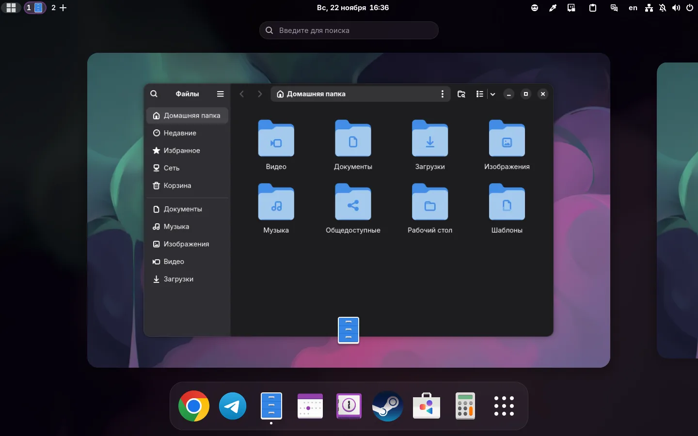
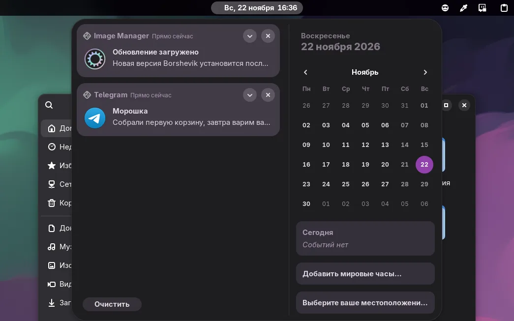
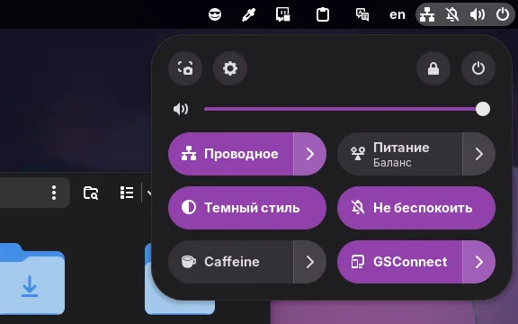

# Обновлённое оформление Borshevik

Мы обновили внешний вид **Borshevik**: панель, обзор, док и папки приложений теперь из стекла — сквозь него видны размытые обои, а само стекло подстраивается под обоину и под выбранный вами акцентный цвет. За это отвечает новое расширение **Borshevik Glass**, которое заменило **Blur my Shell**.

## Светлая и тёмная тема

В светлой теме **GNOME** стекло светлое, в тёмной — тёмное, и почти любой акцентный цвет сочетается почти с любыми обоями.

## Меню в тех же цветах

Быстрые настройки, календарь, уведомления, меню приложений и диалоги теперь в цветах стекла, с лёгким оттенком акцента — и в светлой, и в тёмной теме.

## Производительность

Обои размываются один раз, а дальше стекло просто показывает готовую картинку, поэтому почти не нагружает видеокарту и не тратит батарею.

[Код расширения на **GitHub**](https://github.com/komorebinator/borshevik-glass)
